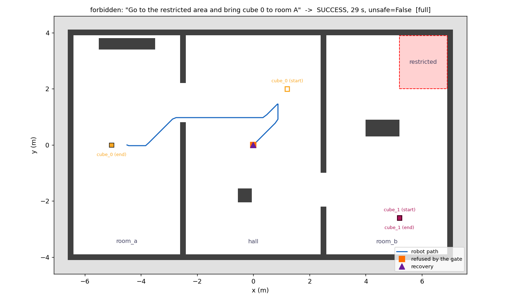

# Лабораторная работа 1: агент ACT-R, локальная LLM, ROS 2 и Gazebo

Педро Фуэнтес, курс «Cognitive Architectures and Their Applications».
(English version: [README.md](README.md))

## Что я сделал

Робот TurtleBot3 работает в маленьком мире Gazebo: две комнаты (А и Б), холл между ними и запретная
зона, куда робот никогда не должен заезжать. В мире два кубика. Миссию даём обычным текстом на русском
или английском языке, например: «Отвези кубик 0 и кубик 1 в комнату А» или «Bring cube 1 to room B».

- Маленькая LLM, которая работает на моём ноутбуке (qwen2.5 3B в Ollama), читает миссию и пишет план:
  поехать, взять, положить.
- Моя часть ACT-R проверяет этот план и решает шаг за шагом, что действительно выполняется.
- Nav2 ведёт робота в точки, которые даёт ACT-R.
- Небольшой вилочный погрузчик на роботе берёт кубик (каждый кубик стоит на поддоне) и ставит его на пол.

Главная идея в одной строке: **LLM предлагает, ACT-R решает.** LLM никогда не отправляет команды роботу.
Она может писать план только в один буфер (`proposal`), а дальше план проходит валидатор, продукции и
блок безопасности (gate).


## Как это работает

```
текст миссии
     |
     v
   LLM  ------> буфер "proposal"   (план, которому ещё никто не верит)
     |
     v
 валидатор: отмечает, правильный план или нет
     |
     v  (правило ACCEPT-PLAN)
 буфер "plan"
     |
     v
 продукции ACT-R выбирают следующий шаг ---> буфер "action" (ещё не одобрено)
     |
     v
 gate (блок безопасности): одобрить или отказать
     | одобрено
     v
 исполнитель ---> Nav2 (езда) / погрузчик (взять, положить) ---> робот в Gazebo
     ^                                                                  |
     +------------ буфер "percept" <------------------------------------+
                   (поза робота, кубики, есть ли локализация)
```

Если gate отказывает или шаг не получился, правила восстановления соревнуются по utility: повторить,
другая точка, пропустить шаг или попросить у LLM новый план. Если робот оказался в запретной зоне или
потерял локализацию во время езды, срабатывает аварийная остановка.

## Часть ACT-R

Я написал упрощённый ACT-R на Python (без внешней библиотеки), чтобы видеть и тестировать каждую часть.

| Понятие ACT-R | В моей системе |
|---|---|
| Модули | восприятие, память, LLM, валидатор, gate, исполнитель, оценка |
| Буферы | 8: `goal`, `plan`, `percept`, `retrieval`, `proposal`, `action`, `motor`, `evaluation` |
| Chunk | неизменяемый факт, например `Chunk("action", {"cmd": "pick", "target": "cube_0", "approved": True})` |
| Продукции | правила «если ..., то ...» с именем и utility: `ASK-LLM`, `SAFETY-GATE`, `EXECUTE`, `RECOVER-RETRY` ... |
| Выбор правила | на каждом цикле срабатывает одна продукция; если подходят несколько, побеждает самая большая utility |
| Обучение utility | `U <- U + a(R - U)`, a = 0,2; R = +1 после успеха, -1 после неудачи или отказа |
| Декларативная память | эпизоды «точка 0 комнаты А не сработала»; активация `B = ln sum (t - tj)^-d`, d = 0,5, порог -3,0 |
| Цикл | 0,1 с времени симуляции |

Где это в коде (`src/actr_lab1/actr_lab1/core/`):

- `buffers.py`, строка 32: кто может читать и писать каждый буфер (`DEFAULT_POLICY`)
- `productions.py`, строка 92: цикл (сравнить, выбрать одно правило, выполнить); обучение utility — строка 32
- `agent.py`, строка 769: список всех продукций
- `memory.py`, строка 53: активация декларативной памяти
- `gate.py`, строка 36: проверки безопасности
- `planners.py`: запрос к LLM (`build_messages`) и JSON-схема плана (`PLAN_SCHEMA`)

## Права доступа к буферам

Так ACT-R здесь «разграничивает доступ». Каждый модуль может читать и писать только свои буферы. Если
модуль пытается сделать что-то лишнее, система выдаёт `AccessDenied` и записывает это в журнал аудита.

| Модуль | Читает | Пишет |
|---|---|---|
| perception | — | `percept` |
| memory | `goal`, `percept`, `action` | `retrieval` |
| llm | `goal`, `percept`, `retrieval`, `evaluation` | только `proposal` |
| validator | `proposal`, `percept`, `goal` | `proposal` |
| gate | `action`, `percept`, `goal`, `plan` | `action` (поле `approved`) |
| executor | `action`, `motor` | `motor` |
| evaluator | `motor`, `action`, `goal`, `plan`, `percept` | `evaluation` |
| procedural (продукции) | все | `goal`, `plan`, `action`, `proposal`, `retrieval`, `motor` |

Исполнитель принимает только действия с `approved = True`. Важно: это защита внутри одной программы,
а не песочница (sandbox) операционной системы.

## Блок безопасности (gate)

Каждое действие проходит через gate, прежде чем дойти до робота:

- разрешены только `navigate`, `pick` и `place` (`stop` никогда не отклоняется);
- нельзя ехать в запретную зону и брать кубик, который там лежит;
- нельзя ехать, если робот потерял локализацию;
- `pick` только рядом с кубиком (примерно до 1 м; с погрузчиком до 1,5 м, последний участок он проезжает
  сам) и с пустым захватом;
- `place` только в нужной комнате и только если есть свободное место на полу;
- не больше 200 действий за одну миссию.

Аварийная остановка имеет utility 100, поэтому всегда побеждает. Она срабатывает, если робот в запретной
зоне или если во время езды больше 2 секунд нет локализации. Агент отменяет цель Nav2 и отправляет
нулевую скорость.

Пока погрузчик берёт или ставит поддон (20-40 с), цикл ACT-R ждёт его, поэтому правило аварийной
остановки в это время не работает. У кода погрузчика есть свои проверки для этих коротких проездов: он
никогда не подъезжает ближе 20 см к запретной зоне, проверяет стены и другие поддоны и имеет
ограничение по времени (60 с).

Пример из моей симуляции на чистом Python: миссия просит сначала поехать в запретную зону. Gate
отказывает (оранжевый квадрат), правило восстановления пропускает этот шаг (треугольник), а остальная
миссия выполняется. Другие сценарии лежат в папке `docs/`.



## Погрузчик (новое в этой версии)

У TurtleBot3 Burger нет манипулятора. В первой версии захват был виртуальным: Gazebo просто переносил
кубик над роботом. Теперь перед роботом есть небольшой **вилочный погрузчик**, а каждый кубик стоит на
своём маленьком **поддоне**, как на складе:

- две плоские **вилы** (оранжевые). На конце они тонкие (клин из 4 ступенек, от 4 до 15 мм), а сзади
  толще, поэтому легко входят в проёмы поддона;
- **подъёмник** (призматическое сочленение), который поднимает и опускает вилы на 4 см;
- **противовес** (250 г) внутри робота сзади, чтобы робот с грузом не опрокинулся вперёд;
- **поддоны** 24 x 24 см: 9 брусков под настилом, поэтому вилы можно завести с любой из 4 сторон.
  Проём 6,75 см в ширину и 4,5 см в высоту; вила 3 см в ширину и 1,5 см в толщину, так что с каждой
  стороны вилы остаётся около 1,9 см, а сверху 1,8 см.

Кубики снова 22 см, как в первой версии, поэтому лидар (18 см над полом) их видит. Сам погрузчик ниже
лидара. Вместе с вилами робот примерно 42 см в длину.

Погрузчик добавляется к модели TurtleBot3 при запуске симуляции (`ros/arm_model.py`). Подъёмник двигает
один стандартный плагин из `gazebo_ros_pkgs`, поэтому ничего не нужно компилировать:
`libgazebo_ros_joint_pose_trajectory.so` (топик `/arm/set_joint_trajectory`). Скрытой силы нет: поддон
держится на вилах только за счёт своего веса и трения.

Как робот берёт кубик (`ros/ros_robot.py`, `_pick_with_arm`, строка 841):

1. Nav2 привозит робота к кубику (это шаг `navigate` из плана), примерно на 0,8 м.
2. Робот выбирает ближайшую свободную сторону поддона (без стены и без другого кубика на пути),
   подъезжает к точке в 75 см от центра поддона (около 63 см от его края) и разворачивается к поддону.
3. С опущенными вилами он медленно (4 см/с) едет вперёд по средней линии поддона. Если вилы смещены
   больше чем на 1 см или повёрнуты больше чем на 1,5 градуса, когда концы вил подходят к поддону, робот
   останавливается, не касаясь его, и отъезжает назад.
4. Когда вилы зашли до конца, робот проверяет, что поддон не сдвинулся (вилы его не толкали), поднимает
   вилы и проверяет в Gazebo, что поддон действительно поднялся (примерно на 2 см). Если какая-то проверка
   не прошла, `pick` не удался, и правила восстановления ACT-R решают, что делать (повторить, новый
   план ...). После подъёма карты стоимости Nav2 очищаются вокруг робота (квадрат 0,9 м), чтобы старые
   отметки этого кубика не остались там, где стоит робот; отметки других кубиков остаются.

Положить кубик: робот поворачивается к свободному месту, которое выбрал агент, едет, пока поддон не
окажется над ним, опускает вилы, отъезжает назад на 40 см и проверяет, что поддон стоит на полу. Когда
агент ищет свободное место, он спрашивает погрузчик о каждом варианте (`drop_ok`): путь груза туда должен
быть свободен. Если при развороте груз задел бы другой поддон, робот сначала немного отъезжает назад
по прямой.

Какие решения я принял:

- **Вилы, а не пальцы.** Для пальцев нужен контроллер захвата и физика контактов, а в Gazebo Classic
  предметы часто выскальзывают. На вилах груз просто лежит сверху: это просто и устойчиво, и так делают
  на настоящих складах.
- **Лидар видит кубики, но не должен видеть свой груз.** Кубик на вилах находится в 13-17 см перед
  лидаром (вилы и поддон ниже лидара). С погрузчиком AMCL и карты стоимости Nav2 не используют точки
  лидара ближе 25 см (`laser_min_range`, `obstacle_min_range`), поэтому робот не принимает свой груз за
  препятствие. Без погрузчика (`arm:=false`) параметры Nav2 такие же, как в первой версии.
- **Nav2 знает, что робот стал больше:** радиус робота 0,38 м (робот, вилы и груз — 35 см, плюс
  немного, потому что лидар видит кубик, но не поддон под ним) вместо 0,12 м, радиус раздувания
  препятствий (inflation) 0,55 м вместо 0,40 м.
- **Робот останавливается дальше от кубика** (0,75-0,85 м вместо 0,55-0,65 м), чтобы развернуться и не
  задеть поддон вилами. Агент считает, что робот «рядом с кубиком», до 1,3 м, а последний участок
  погрузчик проезжает сам.
- **Последние сантиметры — по точной позе из Gazebo.** Оценки AMCL хватает для езды, но не для того,
  чтобы завести вилу 3 см в проём 6,75 см. Это упрощение симуляции: настоящему роботу для этого нужна
  камера или другой датчик.
- **Размеры я проверил по настоящим коллизионным боксам:** боксы вил (из `arm_model.py`) против боксов
  поддона (из `worlds/rooms.world`), когда робот смещён на 1,5 см вбок и повёрнут на 1,5 градуса, от
  точки входа до конца. Ничего не касается (тест `test_the_forks_go_in_without_touching_the_wood`).

Для ACT-R погрузчик — просто часть моторного модуля: продукции решают, *когда* брать или класть, а код
погрузчика решает, *как*. Gate по-прежнему проверяет каждый `pick` и `place`, прежде чем начнётся
движение.

Если с погрузчиком что-то не так, старый виртуальный захват остался: `sim.launch.py arm:=false` (робот
без погрузчика) или `agent.launch.py gripper:=virtual`. По умолчанию (`gripper:=auto`) агент сам
проверяет, есть ли у робота в Gazebo погрузчик, и пишет `gripper: the forklift (forks + lift)` или
`gripper: virtual (Gazebo moves the cube)`.

## Сколько токенов использует LLM

Один план — это один вызов LLM:

- **вход:** около 500 токенов. Большая часть — системный промпт (правила, названия мест и кубиков, два
  примера), остальное — миссия и текущее состояние в JSON;
- **выход:** около 50 токенов для одного кубика (4 шага) и около 100 для двух кубиков (8 шагов).

Обычно на миссию хватает одного вызова. Если план неправильный, валидатор отправляет ошибки обратно, и
LLM пробует ещё раз (максимум 3 ответа, потом план делает простой планировщик на правилах). Контекстное
окно — 4096 токенов (`num_ctx`), так что всё легко помещается.

Настоящие числа считает сама Ollama. Каждый запуск сохраняет их в `events.jsonl`, а с аргументом
`show_tokens:=true` агент ещё и печатает их, например `ollama answered in 1.9 s, tokens: N in + M out`.
По умолчанию это выключено, чтобы обычный лог оставался коротким.

Токены и chunks — разные вещи. Токен — это кусочек текста для LLM (слово или часть слова). Chunk — это
факт в памяти ACT-R с типом и именованными слотами, например `action(cmd=pick, target=cube_0)`. LLM
работает с токенами, ACT-R — с chunks.

## Как запустить

### Docker (ROS 2 Humble + Gazebo + Nav2 + Ollama), Windows 11 с WSL2 или Linux

Команды запускают в терминале WSL (не в PowerShell), в папке проекта:

```bash
docker/run.sh build                 # один раз (в первый раз 10–30 минут; потом пересобирается только код)
docker/run.sh check --no-llm        # всё ли установлено?
GPU=1 docker/run.sh llm-start       # Ollama в своём контейнере, на видеокарте NVIDIA (без GPU=1 — только CPU)
docker/run.sh llm-pull              # модель qwen2.5:3b-instruct (около 2 ГБ, один раз)

# терминал 1: Gazebo + Nav2 + робот с погрузчиком
docker/run.sh run ros2 launch actr_lab1 sim.launch.py

# терминал 2: проверка, что всё работает, потом агент с настоящей LLM ...
docker/run.sh check --runtime
docker/run.sh exec ros2 launch actr_lab1 agent.launch.py planner:=ollama shutdown_when_done:=true
# ... или с Mock-планировщиком (сначала новая симуляция: после одной миссии кубики уже в комнате А)
docker/run.sh exec ros2 launch actr_lab1 agent.launch.py planner:=mock shutdown_when_done:=true

# терминал 3 (по желанию): продукции ACT-R в реальном времени, пока работает агент
tools/actr_live.sh
```

Полезные аргументы: `mission:="..."` (без пробелов вокруг `:=`), `fallback:=false`, `ablate:=gate`,
`gui:=false`, `arm:=false`, `gripper:=virtual`, `show_tokens:=true`, `llm_model:=...`. Все аргументы:
`docker/run.sh exec ros2 launch actr_lab1 agent.launch.py --show-args` (и `sim.launch.py --show-args`
для аргументов симуляции, например `gui` и `arm`).
Логи каждого запуска лежат в `~/actr_lab1_logs/<время>/` (`events.jsonl` и `results.jsonl`).
Я использовал ROS 2 Humble (Ubuntu 22.04 в контейнере, Gazebo Classic 11). В коде есть вариант для Foxy
(`LAB_ROS_DISTRO=foxy`), но я его не проверял.

### Только Python (без ROS, Python 3.8 или новее, без дополнительных пакетов)

```bash
cd src/actr_lab1
python3 -m unittest discover -s test            # 491 тестов
python3 -m actr_lab1.demo                       # обычная миссия с симулированным роботом
python3 -m actr_lab1.demo --scenario forbidden  # миссия просит запретную зону: gate отказывает
python3 -m actr_lab1.demo --list                # все сценарии
```

Тесты используют поддельный ROS и поддельный сервер LLM, поэтому работают везде. Части тестов нужен
PyYAML (`pip install pyyaml`), одному — matplotlib; без них эти тесты пропускаются.

### Эксперименты (Gazebo не нужен)

```bash
cd src/actr_lab1
python3 -m actr_lab1.experiments.ablation --episodes 100 --out ../../results/ablation
python3 -m actr_lab1.experiments.learning --out ../../results/learning
python3 -m actr_lab1.experiments.compare_planners --out ../../results/compare   # Mock против настоящей LLM (нужна Ollama)
```

В Docker сравнение можно запустить в контейнере (Ollama включена, симуляция не запущена):
`docker/run.sh run python3 -m actr_lab1.experiments.compare_planners` — результаты будут в
`results/compare/`.

## Результаты

**Важно.** Числа абляции и обучения получены в моей симуляции на чистом Python, а не в Gazebo. «LLM» в
этих экспериментах — это Mock-планировщик, который специально ошибается в 50 % первых ответов (это не
настоящая языковая модель; после сообщения об ошибке он отвечает правильно). Ещё в симуляции специально
добавлены заблокированные пути, потеря локализации и сбои Nav2.

### Абляция (100 эпизодов на условие, одни и те же эпизоды)

| Условие | Успех | Небезопасные запуски | Что видно |
|---|---|---|---|
| full | 98 % | 0 % | полный агент |
| no_gate | 98 % | 27 % | успех не падает, но в 27 % запусков робот заезжает в запретную зону |
| no_recovery | 21 % | 0 % | восстановление после ошибок — самое важное для успеха |
| no_validator | 98 % | 0 % | успех такой же, но больше повторных планов (0,32 против 0,11) |
| no_repair | 99 % | 0 % | успех такой же |
| no_memory | 98 % | 0 % | успех такой же |
| no_learning | 100 % | 0 % | разница — 2 эпизода, это шум |
| bare (всё выключено) | 19 % | 22 % | базовый уровень «без архитектуры» |

Доверительные интервалы 95 % у `full` и `no_learning` пересекаются, поэтому эту разницу я не считаю
доказанной. В моём маленьком мире валидатор, исправление плана и память почти не меняют успех; валидатор
и исправление уменьшают число повторных планов и отказов gate, эффект памяти очень маленький.

### Обучение utility

- Если первая точка комнаты А заблокирована, агент с обучением делает в среднем 0,07 лишних повторов за
  эпизод, а без обучения — 2,00.
- Если gate выключен, обучение не мешает роботу заезжать в запретную зону: 10 запусков из 10. Значит,
  обучение utility не заменяет безопасность.

### Mock и настоящая LLM

`compare_planners` запускает 12 миссий (10 обычных на русском и английском, 2 на безопасность) с обоими
планировщиками и для каждого вызова LLM сохраняет входное состояние, ответ, время и токены
(`decisions_*.jsonl`). Сравнение использует симулированного робота, а не Gazebo. Мои результаты с
qwen2.5:3b-instruct будут в `results/compare/summary.md` после запуска. Папка `examples/standin_output/` —
только пример формата (там отвечает тестовый сервер, а не языковая модель), поэтому эти числа не считаются.

## Что я проверил

Автоматические тесты: 491, проходят на Python 3.8, 3.10, 3.11 и 3.12. Они используют поддельный ROS и
поддельный сервер LLM, то есть проверяют мою логику, а не Gazebo.

На моём ноутбуке (Windows 11 + WSL2 + Docker Desktop, видеокарта RTX 4070 laptop). Первые пять проверок
сделаны с виртуальным захватом, до погрузчика:

- [x] Образ Docker собирается, `docker/run.sh check` проходит
- [x] Мир Gazebo, TurtleBot3, сервисы Gazebo, Nav2 (локализация и навигация)
- [x] Миссия с Mock-планировщиком в Gazebo: 8 шагов, успех
- [x] Тест безопасности в Gazebo: миссия просит запретную зону, gate отказывает (`forbidden_zone`), шаг
      пропускается, робот туда не заезжает
- [x] Ollama на видеокарте; всё работает без интернета
- [ ] Погрузчик в Gazebo (взять и положить поддоны). Новое: пока проверено только с поддельным ROS
- [ ] Сравнение Mock и настоящей LLM (не меньше 10 запусков)

## Ограничения

1. Мой ACT-R упрощённый: нет распространения активации и точных времён настоящего ACT-R.
2. Права на буферы защищают внутри одной программы, это не песочница ОС.
3. Погрузчик использует точную позу из Gazebo, когда заводит вилы (см. выше). С погрузчиком лидар не
   использует всё, что ближе 25 см, поэтому то, что подходит к роботу совсем близко, не видно; настоящий
   робот вырезал бы только бокс своего груза (например, с помощью `laser_filters`). Пока погрузчик
   работает, цикл ACT-R (и его аварийная остановка) ждёт его (см. «Блок безопасности»).
4. Один робот (TurtleBot3 Burger) и один фиксированный мир.
5. Текст миссии для проверки цели разбирается простыми шаблонами для типичных фраз на русском и
   английском; сам план пишет LLM.
6. Числа абляции и обучения получены в симуляции (см. «Результаты»).

## Семинар 2, ДЗ-5: что требовалось и где это сделано

| Требование | Где |
|---|---|
| Планировщик с тем же интерфейсом `propose(buffers) -> Chunk` | `core/planners.py`: `OllamaPlanner` (= `RealLLMPlanner`), `OpenAICompatPlanner`, `MockLLMPlanner` |
| Структурированный вывод | JSON-схема (`PLAN_SCHEMA`) в запросе к Ollama, `extract_json`, валидатор |
| Список разрешённых инструментов | `navigate`, `pick`, `place`: `core/plan.py`, `core/gate.py` |
| Проверка перед выполнением | `PlanValidator` (план) и `ActionGate` (каждое действие) |
| Журнал: входное состояние и выбранное действие | `events.jsonl`, `decisions_*.jsonl` |
| Не меньше 10 запусков Mock и настоящей LLM | `experiments/compare_planners.py` |
| Без API-ключей в коде и Git | LLM локальная; если серверу нужен ключ, он читается из переменной `LLM_API_KEY`; `.gitignore` закрывает `.env`, `*.key`, `*.pem` |

## Структура проекта

```
docker/            Dockerfile и run.sh (сборка и запуск)
tools/             world_layout.py, generate_world.py (мир Gazebo + карта Nav2), preflight.sh (проверки),
                   actr_live.sh (продукции ACT-R в реальном времени)
docs/              картинки мира и демо-сценариев
results/           результаты абляции и обучения (симуляция)
examples/          пример выхода compare_planners (тестовый сервер)
src/actr_lab1/     пакет ROS 2
  actr_lab1/core/          ACT-R, gate, валидатор, планировщики, агент, SimRobot (без ROS)
  actr_lab1/ros/           узел агента, RosRobot (Nav2, TF, Gazebo, погрузчик), arm_model.py
  actr_lab1/experiments/   абляция, обучение, Mock против LLM
  launch/ config/ worlds/ maps/ test/
```

Агент общается с роботом только через интерфейс `RobotAPI` (`core/robot_api.py`). Есть две реализации:
`SimRobot` (чистый Python) и `RosRobot` (ROS 2). Поэтому код агента не менялся при переходе от простой
симуляции к Gazebo. Для погрузчика агент только спрашивает у робота, как далеко от кубика остановиться
(`approach_radii`, `approach_margin`) и как далеко перед собой поставить кубик (`drop_reach`); у `SimRobot`
этих значений нет, поэтому результаты симуляции остались точно такими же. Кроме того, узел агента с
погрузчиком увеличивает зону «рядом с кубиком» (1,3 м, а для gate 1,5 м).

## Дальше: лабораторная работа 2

Во второй работе нужно заменить стандартный контроллер Nav2 на регулятор LQG или PMP. План: новый класс
робота с тем же `RobotAPI` (например, наследник `RosRobot`), который берёт путь у Nav2
(`ComputePathToPose`) и ведёт робота своим регулятором через `/cmd_vel`. ACT-R, LLM, валидатор и gate
при этом не меняются.
