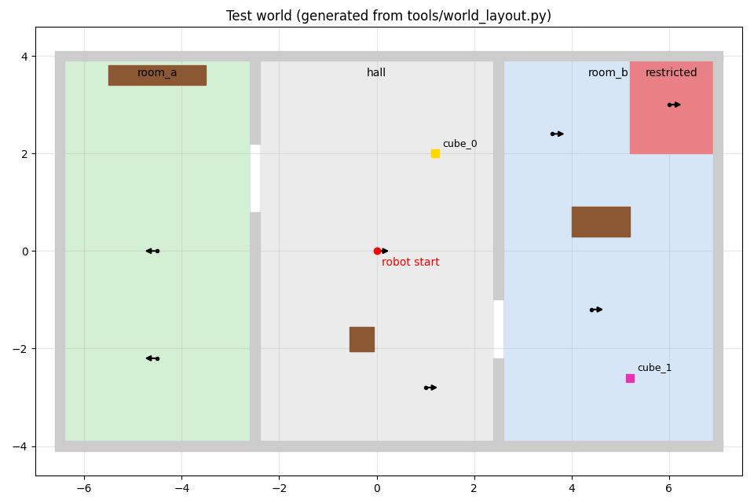
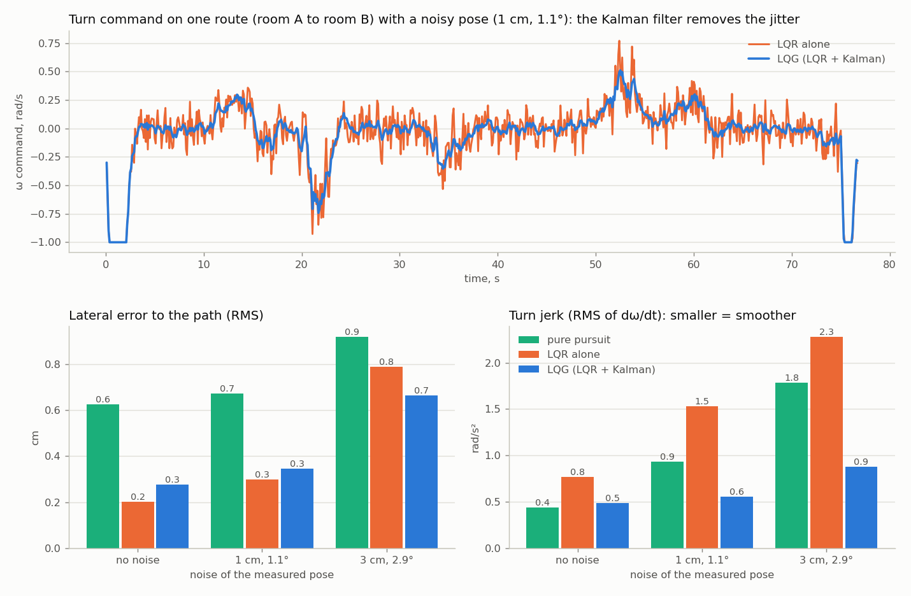

# Lab 2: an LQG controller instead of the standard Nav2 controller

Pedro Fuentes, course "Cognitive Architectures and Their Applications".
(Русская версия: [README_ru.md](README_ru.md))

The task: take Lab 1 and use an LQG or PMP controller to drive the robot, in place of the standard
Nav2 controller. I chose **LQG**: an LQR controller and a Kalman filter.

## What I did

- **Lab 1 is the base.** The ACT-R agent, the local LLM, the safety gate and the forklift are
  the same code (package `actr_lab1`). Lab 1 is explained in [its own README](../../lab_1/actr_lab1_ws/README.md).
- **New package `lqg_nav`.** Its LQG controller drives the robot along the path that the Nav2 planner computes.
  It does the job of the standard Nav2 controller (DWB in TurtleBot3).
- **One parameter changed in Lab 1.** The agent now calls the action `lqg/navigate_to_pose` instead of
  Nav2's `navigate_to_pose`. The action type is the same, so ACT-R did not change at all. (I also added the
  comment `SAFETY LAYER` at the places of the safety layer, see below.)
- **Comparison.** I compared pure pursuit, LQR alone and LQG on 540 runs in a Python simulation with
  noise. The node `track_monitor` measures Nav2's controller and the LQG in the same way in Gazebo.

In one line: **Nav2 says where to go (the path), the LQG controller decides how to move (v, ω).**



## How it works

```
ACT-R + safety gate (Lab 1, unchanged)
     |  action NavigateToPose  (lqg/navigate_to_pose instead of navigate_to_pose)
     v
lqg_navigator (new)  ------ action compute_path_to_pose ------>  Nav2 planner: the path
     |  every 0.1 s:  pose from TF  ->  errors e_y, e_theta  ->  Kalman filter  ->  LQR  ->  v, omega
     |  + its own safety: limits, stop for an obstacle (lidar), no turning near the forks, timeouts,
     |    zero speed without a pose or the lidar and after any error in the code
     v  /cmd_vel
TurtleBot3 with the forklift (Gazebo)
```

Nav2 still runs. Its map server and AMCL give the map and the localization, and its planner gives the path.
Its own controller stays idle unless the agent is started with `controller:=nav2`. So both controllers can be
compared in the same simulation.

## The controller

**State** (two errors with respect to the path):
`e_y` is the distance to the left (+) or right (−) of the path, and `e_θ` is the robot yaw minus the path
direction.
**Control:** `u = ω − v·κ`. Here `v·κ` (κ = curvature of the path) is the turn that the path itself needs,
the feedforward. The LQR adds `u`.

**Model** (linearized for small errors at speed v, step dt = 0.1 s, as the Nav2 controller of TurtleBot3):

```
e_y' = v · e_θ          x[k+1] = A x[k] + B u[k]
e_θ' = u                A = [[1, v·dt], [0, 1]],   B = [[v·dt²/2], [dt]]
```

**LQR.** `u = −K x` makes `Σ (xᵀQx + uᵀRu)` as small as possible. K comes from the discrete Riccati equation,
which my code solves by simple iteration (checked against SciPy).
`Q = diag(100, 6)` means 10 cm of lateral error costs as much as 1 rad/s of extra turning (`R = 1`).
K depends on v, so it is computed once for every 1 cm/s ("gain scheduling"). At v = 0.2 m/s,
`K = [8.5, 2.8]`, and the closed loop has eigenvalues 0.92 and 0.80 (stable, time constants of about 1.2 s and 0.45 s).

**Kalman filter.** The pose from AMCL has noise and small jumps. The filter predicts the errors with the
same A and B and corrects the prediction with each measurement. Its numbers are the model noise per step
(`W`: 3 mm, 0.01 rad) and the pose noise (`V`: 2 cm, 0.03 rad). In steady state each measurement moves the
estimate 14 % (lateral) and 28 % (heading) of the way. **LQR + Kalman filter = LQG.** By the separation
principle the two parts are designed separately.

**Phases and speed.** If the robot looks away from the path (more than 0.8 rad), it first turns in place,
because the linear model needs small errors. Then it tracks the path. At the goal it turns to the yaw of the
goal. The speed is limited by the curvature ahead (`v²·|κ| ≤ 0.3 m/s²`), by the distance to the goal and by
the heading error, with acceleration limits. A fresh path is asked every 1 s, as in Nav2's default behaviour
tree.

Where in the code (`src/lqg_nav/lqg_nav/`):

| What | File, line |
|---|---|
| model A, B | `lqg.py`, line 74 |
| Riccati equation, LQR gain | `lqg.py`, lines 80 and 96 |
| Kalman filter (predict, update) | `lqg.py`, line 125 |
| one control step (phases, speed, safety) | `tracker.py`, line 123 |
| the steering law: feedforward + LQR on the Kalman estimate | `tracker.py`, line 219 |
| the ROS node (action server, planner, TF, lidar, /cmd_vel) | `navigator_node.py`, line 266 |

## Where the safety layer is

| Level | What it does | Where |
|---|---|---|
| 1. ACT-R safety gate | checks every action before it starts: restricted zone, localization, distance to the cube ... | `actr_lab1/core/gate.py`, line 36 |
| 2. EMERGENCY-STOP rule | utility 100: in the zone or without localization while driving, it cancels the goal and sends zero speed | `actr_lab1/core/agent.py`, line 809 |
| 3. Access control | the LLM can write only `proposal`; the executor runs only actions with `approved = True` | `actr_lab1/core/buffers.py`, line 32; `agent.py`, line 278 |
| 4. The LQG controller (new) | limits of speed and acceleration; stops for an obstacle in front (lidar); no turning in place when something is closer than the forks; fails after a long block or without progress, and then ACT-R decides; zero speed without a pose or the lidar and after any error in the code | `lqg_nav/tracker.py`, lines 176, 184 and 235; `navigator_node.py`, lines 315 and 253 |
| 5. The forklift's short drives | never closer than 20 cm to the restricted zone | `actr_lab1/ros/ros_robot.py`, line 697 |

A cancel from ACT-R (levels 1-2) reaches the controller as a cancel of the action: it stops at once
(`navigator_node.py`, line 359).
Every place in the table is marked in the code with the comment `SAFETY LAYER <level>`, so one search lists them
all (Ctrl+Shift+F in VS Code, or `grep -rn "SAFETY LAYER" src`).

## Results

### Python simulation (540 runs, not Gazebo)

6 routes on the map of the world (A* paths, like the Nav2 planner), 10 seeds, 3 levels of noise on the measured pose.
The robot is a simulated unicycle with motor lag and slip (`lqg_nav/unicycle.py`). The three controllers get
the same noise (a paired comparison), and only the steering law differs. All 540 runs reached the goal.

| pose noise | controller | lateral error RMS, cm | lateral error max, cm | turn jerk RMS, rad/s² |
|---|---|---|---|---|
| none | pure pursuit | 0.6 | 1.9 | 0.44 |
| none | LQR | 0.2 | 0.8 | 0.76 |
| none | **LQG** | 0.3 | 1.0 | 0.48 |
| 1 cm, 1.1° (like AMCL) | pure pursuit | 0.7 | 2.0 | 0.93 |
| 1 cm, 1.1° | LQR | 0.3 | 1.0 | 1.53 |
| 1 cm, 1.1° | **LQG** | 0.3 | 1.1 | **0.55** |
| 3 cm, 2.9° | pure pursuit | 0.9 | 2.4 | 1.78 |
| 3 cm, 2.9° | LQR | 0.8 | 2.2 | 2.28 |
| 3 cm, 2.9° | **LQG** | **0.7** | **1.7** | **0.88** |

What it shows:
- **LQR follows the path best.** With little noise its error is less than half that of pure pursuit.
  However, it reacts to every bit of noise: its turn command jumps.
- **The Kalman filter removes the jitter.** With AMCL-like noise the LQG turns 2.8 times more smoothly than the
  LQR alone, with the same error. With strong noise it also has the smallest error.
- Time and final error are the same for the three (about 46 s, 2-5 cm).



**Whole missions.** The ACT-R agent of Lab 1, unchanged, also ran whole missions on the simulated robot driven
by the LQG (`lqg_nav/sim_robot.py`): 6 missions × 4 seeds, pose noise 2 cm and 0.03 rad. All 24 succeeded,
none entered the restricted zone, no navigate step failed, and the robot never came closer than 10 cm to a wall.

All numbers: `results/lqg/summary.md`, every run: `results/lqg/runs.jsonl`.
**Honest note:** these are small differences in a simple simulated robot. The paths of this world are
smooth and the robot is slow, so all controllers stay within about 2 cm. Pure pursuit only stands in for a
classic controller. The real Nav2 controller (DWB) can only be compared in Gazebo (next section).

### Gazebo: Nav2 controller against LQG

The node `track_monitor` runs with the simulation. It measures the same things for whichever controller
drives: the distance to the latest path of the planner, the smoothness of `/cmd_vel` and the time of the
navigate steps. After every mission it adds one line to `~/actr_lab2_logs/tracking.jsonl`.
The table is printed by `python3 tools/tracking_table.py`. My runs are in `results/lqg/gazebo.md`.

## How to run it

The Docker setup is the one of Lab 1 (see its README). The image is `actr_lab2:humble` and the logs go to `~/actr_lab2_logs`.

```bash
docker/run.sh build                 # once (it reuses the big layers of the Lab 1 image)
GPU=1 docker/run.sh llm-start       # Ollama (the same container and model as Lab 1)

# terminal 1: Gazebo + Nav2 + the LQG controller + the monitor
docker/run.sh run ros2 launch lqg_nav sim.launch.py

# terminal 2: check, then the mission; the LQG drives
docker/run.sh check --runtime
docker/run.sh exec ros2 launch lqg_nav agent.launch.py planner:=ollama shutdown_when_done:=true

# to compare: a new simulation, then the same mission with the standard Nav2 controller
docker/run.sh exec ros2 launch lqg_nav agent.launch.py planner:=ollama shutdown_when_done:=true controller:=nav2
python3 tools/tracking_table.py     # on your computer: the table of all missions
```

Useful arguments: `steering:=lqr` or `steering:=pure_pursuit` (of `sim.launch.py`, to compare the laws in Gazebo),
`pose_noise:=0.02 yaw_noise:=0.03` (noise added to the measured pose, to see the Kalman filter at work),
and all the arguments of Lab 1 (`mission:=...`, `arm:=false`, `gui:=false` ...).
The containers of Lab 2 use the ROS domain 2, so they never mix with a Lab 1 container.

**Without ROS** (Python 3.8 or newer):

```bash
cd src/lqg_nav
python3 -m unittest discover -s test     # 81 tests: controller, nodes (fake ROS), launch files, whole missions
python3 -m lqg_nav.experiment            # the comparison above (about 40 s; matplotlib for the figure)
cd ../actr_lab1 && python3 -m unittest discover -s test     # the 491 tests of Lab 1
```

## What I checked, and what not

- Checked: the Riccati solution against SciPy, the stability of the closed loop, the Kalman filter,
  every phase and safety rule of the controller, and the node with a fake ROS. The node tests cover goal,
  cancel, a newer goal, a goal in a wrong frame, no path, a lost answer of the planner, no localization, no lidar,
  an obstacle and an error inside the controller.
  The launch files are checked as well. Whole missions of the agent of Lab 1 run with the LQG on the simulated
  robot, and the agent of Lab 1 still passes its 491 tests.
- Not checked by me: the real ROS 2 and Gazebo. That run is on my laptop (results/lqg/gazebo.md).

## Limitations

- The model is linear: it holds for small errors. Large heading errors are handled by turning in place first.
- The Kalman filter smooths the pose errors from AMCL. It does not fuse the odometry and the IMU itself
  (AMCL and the odometry already do that).
- The controller does not plan around obstacles. It stops, asks for a fresh path and, if it stays blocked,
  fails, so that ACT-R chooses a recovery (retry, other waypoint, new plan).
- PMP (optimal control by Pontryagin's principle) was the other option of the task; I did not build it.

## Project structure (what is new)

```
src/lqg_nav/                 Lab 2
  lqg_nav/lqg.py             model, Riccati equation, LQR gain, Kalman filter (plain Python, 2x2 matrices)
  lqg_nav/path.py            the path of the planner: smoothed, evenly spaced, heading and curvature
  lqg_nav/tracker.py         one control step: phases, speed profile, steering, safety
  lqg_nav/navigator_node.py  ROS 2 node lqg_navigator (action lqg/navigate_to_pose)
  lqg_nav/monitor_node.py    ROS 2 node track_monitor (measures any controller in Gazebo)
  lqg_nav/unicycle.py        simulated robot for the experiment and the tests
  lqg_nav/sim_robot.py       the Python robot of Lab 1, driven by the LQG (whole missions without Gazebo)
  lqg_nav/experiment.py      pure pursuit vs LQR vs LQG
  launch/                    sim, agent and all (they include the launch files of Lab 1)
  config/lqg.yaml            the numbers of the controller
src/actr_lab1/               Lab 1 (only the parameter nav_action is new)
tools/tracking_table.py      the Gazebo comparison table
```
